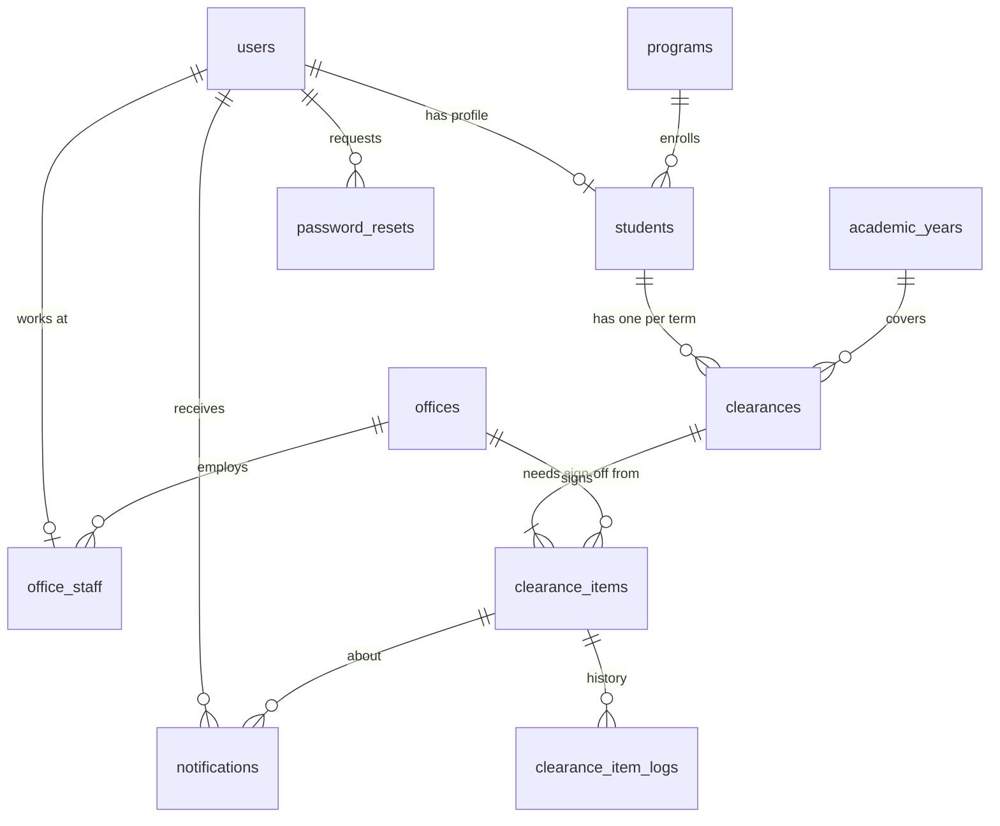
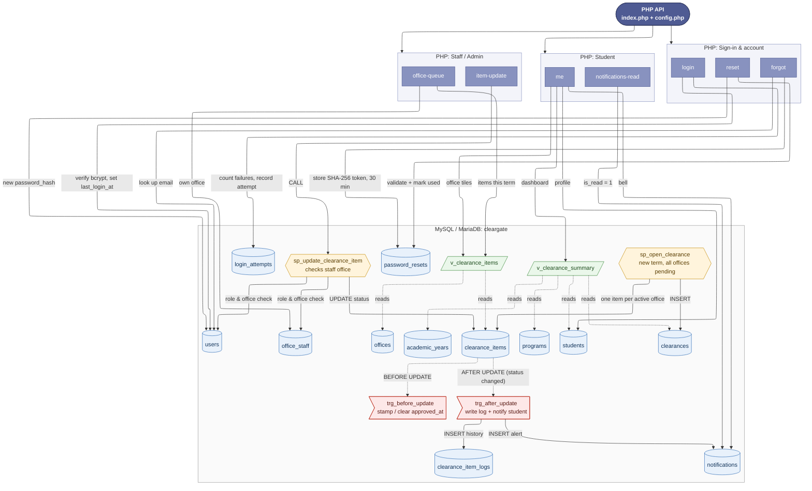

# ClearGate Student Clearance Website

ClearGate is a student clearance website backed by a MySQL database and a PHP API.
Students track their sign-offs from every school office; office staff and admins
update those sign-offs, and the student is notified automatically.
It is built for **XAMPP**: MariaDB 10.4+ and PHP 8.1+. It also works on MySQL 8.

| Path | What it is |
|---|---|
| `index.html` | Student sign in (student ID or email) |
| `staff-login.html` | Staff and admin sign in (office staff and administrators only) |
| `signup.html` | Student application form (photo, personal details, address, parents/guardian). The Registrar approves it |
| `application-status.html` | Applicant's status page: pending, then the student ID, school email and temporary password once approved |
| `change-password.html` | Set a new password (required after signing in with a temporary password) |
| `dashboard.html` | Student dashboard: overall progress and what needs action |
| `requirements.html` | Student checklist of every office requirement (searchable) |
| `clearance-status.html` | Student office-by-office status, next steps and enrollment eligibility |
| `profile.html` | My Profile (all roles): details, editable contact info, profile picture, change password |
| `staff.html` | Staff/admin **Pending List**: evidence students uploaded, waiting for review |
| `review.html` | Staff/admin **Review Item**: preview the file, tick the checklist, then Approve or Return for correction |
| `history.html` | Staff/admin **Review History**: every approval and return, with reviewer and reason |
| `applications.html` | Registrar/admin **Applications**: review sign-ups with photo, approve (creates the account) or reject |
| `office-status.html` | Staff/admin **Clearance Status**: every student's sign-off for the office, with manual updates |
| `messages.html` | Staff/admin **Messages**: conversations with students about a requirement |
| `deadlines.html` | Staff/admin **Deadlines & Reminders**: office deadlines for the term, student-specific deadlines, and reminders sent now or scheduled |
| `reports.html` | Registrar/admin **Reports**: progress by program and year level, office workload and wait times, export to Excel (CSV) |
| `audit.html` | Registrar/admin **Audit Log**: searchable record of status changes, uploads, reviews, applications and admin changes (CSV export) |
| `settings.html` | Admin **Settings**: offices, programs, academic years, and opening a new term |
| `staff-accounts.html` | Admin **Staff Accounts**: create accounts, turn them off or on, and issue temporary passwords |
| `forgot-password.html`, `reset-password.html` | Password reset; returns to sign-in when done |
| `assets/` | Styles, scripts (`assets/js/main.js` talks to the API), images, and `assets/data/ph-*.json` (Philippine regions to barangays, PSGC 2025) |
| `api/index.php`, `api/config.php` | PHP JSON API and its database settings |
| `api/uploads/` | Uploaded evidence files (blocked from direct download; served only to the student, that office's staff and admin) |
| `database/cleargate_db.sql` | Creates the `cleargate` database: tables, triggers, procedures, views and demo data |
| `database/queries.sql` | Ready-made queries: dashboards, office queues, eligible students, audit trail |
| `database/cleargate_database_flowchart.png` | Flow chart of how the API uses the database |
| `install-to-xampp.ps1` | Copies the website and API into `C:\xampp\htdocs\cleargate` |

Amounts are in Philippine pesos, written as PHP (e.g. PHP 3,600).

## Set up in 4 steps

1. **Start XAMPP.** Open the XAMPP Control Panel and start **Apache** and **MySQL**.
2. **Import the database.** Go to http://localhost/phpmyadmin, open the **Import** tab,
   choose `database/cleargate_db.sql`, then click **Import**.
3. **Copy the website into XAMPP.** In this folder, right-click → *Open in Terminal*, then run:
   ```powershell
   powershell -ExecutionPolicy Bypass -File .\install-to-xampp.ps1
   ```
4. **Open it.**
   - http://localhost/cleargate/api/index.php?route=health should show `"database":"connected"`
   - http://localhost/cleargate/ is the website

Re-importing `cleargate_db.sql` resets everything to the demo data. The pages need the
PHP API, so open them through `http://localhost/cleargate/`, not by double-clicking the HTML files.

## Demo accounts

All demo accounts share the password **`ClearGate2026!`**. Change it before anyone else uses the system.

| Who | Sign in with | Clearance |
|---|---|---|
| Ariel Tapnio (student) | `2024-00123` or `tapnioariel@cgateway.edu.ph` | 4 of 6, Library needs action, Accounting pending (PHP 3,600) |
| Justin Edelf Khalil Resoso (Library) | `resosojustinlibrary@cgateway.edu.ph` | Library only |
| Gerardo Maligro Jr. (Accounting) | `maligrogerardoaccounting@cgateway.edu.ph` | Accounting only |
| James Bordeos (Registrar) | `bordeosjamesregistrar@cgateway.edu.ph` | Registrar only |
| Yel Tapnio (Guidance Office) | `tapnioyelguidance@cgateway.edu.ph` | Guidance Office only |
| Aldrin Sundiam (Dean's Office) | `sundiamaldrindean@cgateway.edu.ph` | Dean's Office only |
| Eugene Maritinito (Property Custodian) | `maritinitoeugeneproperty@cgateway.edu.ph` | Property Custodian only |
| Denver Loreto (System Admin) | `loretodenveradmin@cgateway.edu.ph` | Every office |

New students apply on **Apply for an account**. They don't pick a student ID: the Registrar (or admin) reviews the
application and approving it creates the student ID (e.g. `2026-00001`), the school email (`surnamefirstname@cgateway.edu.ph`)
and a temporary password. The applicant sees these on the application status page and must set their own password at first sign-in.
Forgot password accepts either the school email or the personal email.
Students upload evidence (PDF, JPG, PNG or WEBP, up to 5 MB) for an office from **My Requirements** or **Clearance Status**.
The upload sets that office to Pending and puts it on the office's Pending List. Staff review it, then approve it (the office is cleared)
or return it with a reason (the office goes back to Needs action and the student can resubmit). Each decision notifies the student.

Students sign in on `index.html` and land on the dashboard. Office staff and admins sign in on `staff-login.html` and land on the Pending List. Each page refuses the other kind of account.
When staff save an update, the student sees it (and a bell notification) the next time a page loads.

## How the data fits together



- A **student** gets one **clearance** per term. It holds one **clearance item** per
  office (Library, Accounting, Registrar, Guidance, Dean's Office, Property Custodian).
- Each item is `needs_action` (the student must do something), `pending` (the office is
  reviewing) or `approved`. The student is **eligible to enroll** when every item is approved.
- **Office staff** can only change items for their own office. The procedure
  `sp_update_clearance_item` enforces this.

### Database flow chart

How each PHP API route reads and writes the database: tables, views, stored procedures and triggers.
Open this file in VS Code and press `Ctrl+Shift+V` to see it drawn (needs the *Markdown Preview Mermaid Support* extension; VS Code offers to install it).



Image version: [cleargate_database_flowchart.png](database/cleargate_database_flowchart.png)

### Automatic behaviour (triggers)

When an item's status changes:
1. `approved_at` is stamped, or cleared if the item leaves approved.
2. A row is added to `clearance_item_logs` with the old status, the new status, who changed it, and the note.
3. The student gets a **notification** ("Library cleared you", "Accounting needs action", …),
   which shows up under the bell on the website.

### Views

- `v_clearance_summary`: one row per clearance with approved/pending/needs-action counts,
  `percent_complete` and `is_eligible`. This is the dashboard.
- `v_clearance_items`: each office sign-off joined with the office's contact details.

### Procedures

- `CALL sp_open_clearance(student_id, academic_year_id, '2nd Semester')` opens a new term
  with every office pending.
- `CALL sp_update_clearance_item(item_id, status, task, remarks, description, next_step, note, staff_user_id)`
  is how staff change a status. It checks that the staff member belongs to that office.

## API reference

Base URL: `http://localhost/cleargate/api/index.php?route=…`
POST bodies are JSON (`Content-Type: application/json`). Sign-in uses a session cookie.

| Route | Method | Who | Body / query | Returns |
|---|---|---|---|---|
| `health` | GET | anyone | | `{api, database}` |
| `login` | POST | anyone | `{login, password, remember}` | profile (same as `me`) |
| `programs` | GET | anyone | | program codes and names for the application form |
| `apply` | POST (multipart) | anyone | application fields + `photo`, header `X-ClearGate: 1` | `{reference, token}` |
| `application-status` | POST | anyone | `{reference, token}` or `{reference, personal_email, birthday}` | status, and the new account once approved |
| `change-password` | POST | signed in | `{current_password, new_password}` | |
| `applications` | GET | Registrar/admin | `&status=pending\|approved\|rejected` | list + counts |
| `application` | GET | Registrar/admin | `&id=` | one application |
| `application-photo` | GET | Registrar/admin (`&id=`), student (`&mine=1`) | | the 2x2 photo |
| `review-application` | POST | Registrar/admin | `{id, decision: approve\|reject, reason?}` | the application (with the new account) |
| `reset-temp-password` | POST | Registrar/admin | `{id}` | a new temporary password |
| `logout` | POST | anyone | `{}` | |
| `me` | GET | signed in | | student, clearance summary, items, notifications |
| `notifications-read` | POST | signed in | `{}` | marks all as read |
| `forgot` | POST | anyone | `{email}` | generic message (+ `demo_token` in demo mode) |
| `reset` | POST | anyone | `{token, password}` | |
| `submit-evidence` | POST (multipart) | student | `item_id`, `file`, `note?` + header `X-ClearGate: 1` | `{submission_id, reference}` |
| `submission-file` | GET | owner student, office staff, admin | `&id=` (`&download=1` to save) | the file |
| `pending-list` | GET | staff/admin | admin: `&office=library` | submissions waiting + today's counts |
| `submission` | GET | staff/admin | `&id=` | one submission with student, requirement and earlier files |
| `review-submission` | POST | staff/admin | `{submission_id, decision: approve\|return, checklist[], return_category?, reason?}` | the decision record |
| `review-history` | GET | staff/admin | `&decision=approved\|returned`, admin: `&office=` | decided submissions |
| `office-queue` | GET | staff/admin | `&status=pending`, admin: `&office=library` | items for the office this term |
| `item-update` | POST | staff/admin | `{item_id, status, task?, remarks?, description?, next_step?, note?}` | updated item |
| `reports` | GET | Registrar/admin | | current-term progress by program, year level and office |
| `report-export` | GET | Registrar/admin | | CSV of every student's clearance (opens in Excel) |
| `audit-log` | GET | Registrar/admin | `&from=YYYY-MM-DD&to=YYYY-MM-DD` (`&csv=1` to download) | status changes, uploads, reviews, applications, admin changes |
| `settings` | GET | admin | | offices, programs, academic years, current term |
| `save-office` | POST | admin | `{office_id?, code (new only), name, contact_email, office_hours, icon, sort_order, is_active, add_to_open?}` | `{office_id, added_to}` |
| `save-program` / `delete-program` | POST | admin | `{program_id?, code, name}` / `{program_id}` | |
| `save-year` / `set-current-year` | POST | admin | `{start_date, end_date}` / `{academic_year_id}` | |
| `open-term` | POST | admin | `{academic_year_id, term}` | `{opened, already}` |
| `staff-accounts` | GET | admin | | staff and admin accounts |
| `save-staff` | POST | admin | `{user_id?, full_name, email, role, office?, position?}` | `{user_id, temp_password}` (new accounts) |
| `staff-status` / `staff-reset-password` | POST | admin | `{user_id, active}` / `{user_id}` | — / `{temp_password}` |
| `deadlines` | GET | staff/admin | | office deadlines, students, reminders for the current term (staff: their office) |
| `save-deadline` | POST | staff (own office) / admin | `{office: code\|"all", due_at: "YYYY-MM-DDTHH:MM", note?, notify?}` or `{office, clear: true}` | `{due_at, notified}` |
| `item-deadline` | POST | staff (own office) / admin | `{item_id, due_at\|null, notify?}` | `{due_at}` |
| `send-reminder` | POST | staff (own office) / admin | `{audience: outstanding\|overdue\|student, office?, item_id?, message, send_at?}` | `{reminder_id, sent_to, send_at}` |
| `cancel-reminder` | POST | staff (own office) / admin | `{reminder_id}` | |
| `update-profile` | POST | signed in | students: `{personal_email, phone, current_address, emergency_name, emergency_contact}`; staff/admin: `{full_name, position?, phone}` | the profile (same as `me`) |
| `upload-avatar` | POST (multipart) | signed in | `avatar` (JPG/PNG/WEBP, up to 2 MB) + header `X-ClearGate: 1` | `{avatar}` |
| `remove-avatar` | POST | signed in | `{}` | |
| `avatar` | GET | signed in | `&id=` (students: own or staff; staff/admin: anyone) | the picture |
| `backups` | GET | admin | | saved backups in `api/backups` |
| `create-backup` | POST | admin | `{}` | `{file, size}` |
| `download-backup` | GET | admin | `&file=` (none: makes a fresh one) | the .sql file |

Every response is `{"ok": true, "data": …}` or `{"ok": false, "error": {"code", "message"}}`.

### Security built in

- Passwords are stored as **bcrypt** hashes (`password_hash`), never as plain text.
- After **5 failed sign-ins** for an account, or 20 from one IP, sign-in is blocked for 15 minutes.
- Password reset tokens are random, stored only as SHA-256 hashes, expire after **30 minutes**, and work once.
- Session cookies are `HttpOnly` and `SameSite=Lax`. POSTs must be JSON from the same site, which blocks cross-site request forgery.
- All SQL uses prepared statements, so input can't inject SQL.

### Before using it for real

- In `api/config.php`, set `demo_mode` to `false`. Then `forgot` stops returning the reset
  token, and you need to email it instead.
- Give MySQL's `root` account a password, or create a dedicated user, and put it in `config.php`.
- Change every demo password, or delete the demo accounts.
- Serve the site over HTTPS. The session cookie then becomes `Secure` automatically.

### Deadlines and reminders

- Each office can set one deadline per term; a student can be given their own date (`clearance_items.due_at`), which wins over the office one.
- After a deadline the requirement shows **Overdue**, but students can still upload and staff can still approve.
- Reminders appear in the student's bell. Scheduled reminders, and the automatic ones (3 days before, 1 day before, and once when overdue), are sent by the API itself the next time anyone uses the site, so no Windows task is needed. They go out within a minute of someone opening ClearGate.
- Staff and admins have a bell too. Office staff hear about new evidence uploads and student messages for their office. The Registrar and admins hear about new student applications. Staff and admins are told when one of their deadlines passes, and authors when a scheduled reminder goes out. Clicking a notification opens the right page.

### Backups

- ClearGate saves a full backup (tables, data, triggers, procedures, views) to `api/backups` once a day while the site is in use, keeping the newest 14. Admins can also save or download one from **Settings → Backups**.
- To restore: phpMyAdmin → **Import** → choose the .sql file. It recreates the `cleargate` database.
- Copy a backup off the computer now and then (Google Drive, USB). Always click **Stop** on MySQL before shutting down, since cutting power while MySQL runs is what corrupts its files.

